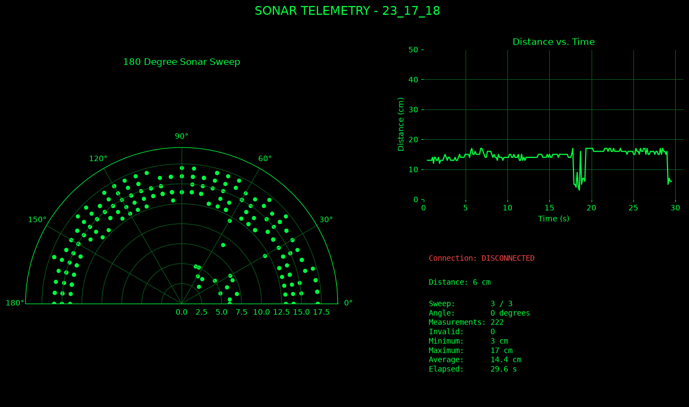

## Isaac and Ivan Chen's Sonar Telemetry Project

A servo-mounted sonar built around an ATmega328PB, an ultrasonic sensor, and a servo motor. The servo sweeps the sensor through 180° and streams each reading over a serial connection. A Python script reads the stream and plots the points on a live radar display.

### Parts

- ATmega328PB Board
- HC-SR04 ultrasonic sensor
- Servo Motor

### How It Works

The firmware, written in embedded C, drives both the servo and the ultrasonic sensor. The servo moves in 5° steps, and at each step the sensor takes one distance measurement. The angle and distance are sent over serial as a line of text.

A Python script reads the serial port and plots each point on a polar graph as it arrives, with the plot updating live and the scale adjusting to the incoming data. When the run finishes, the script prints a telemetry summary to the terminal, saves the readings to a CSV file, and saves an image of the final plot as a PNG.

### Contributors

- **Ivan Chen** ([@CowchPotatoe](https://github.com/CowchPotatoe/))
- **Isaac Chen** ([@ChipperPotato](https://github.com/ChipperPotato/))
